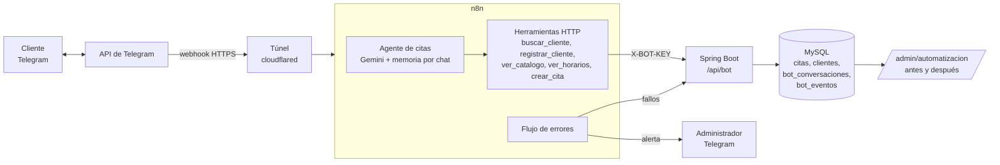

# U4: Automatización No-Code, agente de citas por Telegram

## Problema que resuelve

Agendar una cita por chat hoy depende de una persona: responder cada mensaje, revisar qué barbero está libre,
anotar los datos del cliente y registrar la reserva en el sistema. Fuera del horario del local nadie responde,
y en horas punta los mensajes se acumulan.

## Solución

Un **agente de IA en n8n** atiende el chat de Telegram de la barbería. El cliente escribe en lenguaje natural
("quiero un corte con Luis mañana a las 4") y el agente lo guía hasta dejar la cita registrada en el sistema,
sin intervención del personal. La cita queda **pendiente** y aparece en Citas y Recepción igual que las de la web;
el pago se hace en el local.

La IA solo conversa y decide qué herramienta usar. **Todas las reglas están en el backend**: aunque el modelo se
equivoque o el cliente insista, la API no deja guardar una cita inválida.



| Pieza | Herramienta |
|---|---|
| Canal | Bot de Telegram (creado con @BotFather) |
| Orquestación No-Code | n8n 2.44 (`n8n/workflows/*.json`, se importan solos al arrancar) |
| IA | Gemini (misma clave que el asesor de la U2) con nodo AI Agent y un modelo de respaldo |
| Reglas y datos | Spring Boot (`BotAgendaService`, `BotApiController`) y MySQL |
| URL pública | Túnel gratuito de cloudflared (sin cuenta) |

## Flujo de la conversación

1. El cliente escribe al bot. n8n registra el mensaje en el backend (`POST /api/bot/mensajes`), que abre o continúa
   la conversación y dice si ese chat ya pertenece a un cliente.
2. Si no está identificado, el agente pide el DNI (`buscar_cliente`). Si no existe, toma el nombre de RENIEC
   (o se lo pide), pide el celular y lo registra (`registrar_cliente`). El chat queda asociado al DNI.
3. Muestra servicios con precio y barberos (`ver_catalogo`) y las horas libres reales (`ver_horarios`).
4. Presenta un resumen y solo con un "sí" explícito crea la cita (`crear_cita` con `confirmado = true`).
5. Envía el comprobante con el código `LC-00000`, la fecha, la hora, el precio y las indicaciones.

El identificador del chat (`X-CHAT-ID`) lo pone n8n desde el mensaje de Telegram, no la IA, así que el modelo no
puede hacerse pasar por otro cliente.

## Manejo de excepciones

| Caso | Qué hace el sistema | Dónde se controla |
|---|---|---|
| DNI que no tiene 8 dígitos | Lo pide de nuevo (`DNI_INVALIDO`) | Backend |
| DNI no registrado | Usa RENIEC y pide solo lo que falta; sin RENIEC pide nombre y apellido (`FALTAN_DATOS`) | Backend |
| Celular inválido | Pide 9 dígitos que empiecen con 9 (`TELEFONO_INVALIDO`) | Backend |
| Servicio o barbero inexistente o inactivo | Vuelve al catálogo (`SERVICIO_INVALIDO`, `BARBERO_INVALIDO`) | Backend |
| Fecha mal escrita, pasada o a más de 30 días | Explica la regla (`FECHA_INVALIDA`, `FECHA_PASADA`, `FECHA_MUY_LEJANA`) | Backend |
| Día libre del barbero | Ofrece otro día u otro barbero (`DIA_LIBRE_BARBERO`) | Backend |
| Hora fuera de 10:00 a 22:00, fuera de los turnos de 30 min o ya pasada | `FUERA_DE_HORARIO`, `HORA_PASADA` | Backend |
| Horario tomado mientras el cliente decidía | Revisa de nuevo al guardar y ofrece las 3 horas libres más cercanas (`HORARIO_OCUPADO`) | Backend, con bloqueo para dos chats a la vez |
| Cliente con una cita pendiente | Le muestra la que tiene (`CITA_ACTIVA_EXISTENTE`) | Backend |
| Doble "sí" o reintento de n8n | Devuelve la misma cita, no la duplica (`yaRegistrada`) | Backend (idempotencia por conversación) |
| Crear sin confirmación | Se rechaza (`SIN_CONFIRMACION`) | Backend |
| Foto, audio o sticker | "Por ahora solo puedo leer mensajes de texto" | n8n |
| Gemini saturado o caído | Reintento, modelo de respaldo y, si igual falla, mensaje de disculpa y registro del fallo | n8n |
| Backend caído | 3 reintentos; después mensaje de disculpa y registro del fallo | n8n |
| Cualquier otro error | El flujo **Errores del bot** lo guarda en la bitácora y avisa al administrador por Telegram | n8n (Error Trigger) |
| Llamada sin clave o con clave falsa | 401 sin datos | Backend (`X-BOT-KEY`) |

Cada error controlado responde `{"ok": false, "codigo", "mensaje"}` para que el agente lo explique con sus
palabras, y queda en la tabla `bot_eventos`. Para que todo quede registrado, el agente tiene la regla de no
decidir por su cuenta si un DNI, una fecha o una hora son válidos: siempre los pasa al backend (la hora que pidió
el cliente va en `ver_horarios`, que la valida antes de ofrecer otras).

## Evidencia de eficiencia

El panel **Administración > Automatización** (`/admin/automatizacion`) compara:

- **Antes (línea base):** agendamientos manuales cronometrados que se registran en el mismo panel
  (minutos que el personal estuvo atendiendo y minutos totales hasta que el cliente tuvo su cita).
- **Después:** cada conversación del bot queda en `bot_conversaciones` con inicio, fin, mensajes, errores y resultado.

| Indicador | Cálculo |
|---|---|
| Tiempo promedio para agendar | fin − inicio de las conversaciones con cita, frente al promedio manual |
| Reducción del tiempo | (manual − bot) / manual |
| Minutos de personal ahorrados | citas del bot × minutos de atención manual |
| % sin intervención humana | citas creadas / conversaciones cerradas (las que no terminan en cita y llevan 30 min sin mensajes cuentan como abandonadas) |
| Errores controlados por tipo | conteo de `bot_eventos` |
| Fallos no controlados | eventos `FALLO` (la meta es cero) |
| Citas fuera del horario del local | conversaciones que terminaron en cita fuera de 10:00 a 22:00 |

Los mismos datos salen en JSON en `GET /api/bot/metricas`. Antes de una medición o de la demo, el botón
**Limpiar bitácora del bot** del panel borra conversaciones y errores registrados (no toca citas ni la línea base).

## Cómo se ejecuta (Windows / PowerShell)

1. En Telegram, escribe a **@BotFather**, envía `/newbot`, elige nombre y usuario, y copia el token.
2. En el `.env` completa:
   - `TELEGRAM_BOT_TOKEN`: el token de BotFather.
   - `GEMINI_API_KEY`: la misma del asesor IA.
   - `BOT_API_KEY` y `N8N_ENCRYPTION_KEY`: dos claves largas que inventas. Una forma de generarlas en PowerShell
     (**el comando muestra la clave en pantalla**, pégala directo en el `.env`):
     `[Convert]::ToBase64String((1..32 | ForEach-Object { Get-Random -Maximum 256 }))`
   - Opcional `BOT_GEMINI_MODEL` y `BOT_GEMINI_FALLBACK_MODEL`: modelos del bot. Por defecto usa
     `gemini-3.5-flash-lite` y, si falla, `gemini-3.8-flash`. El lite va primero porque el otro a veces responde
     503 por alta demanda y n8n lo reintenta varias veces antes de pasar al respaldo (las respuestas tardaban minutos).
   - Opcional `TELEGRAM_ADMIN_CHAT_ID`: tu número de chat (te lo da @userinfobot) para recibir las alertas.
3. Levanta todo:
   ```powershell
   docker compose --profile iot --profile bot up -d --build
   docker compose logs n8n | Select-String "trycloudflare"
   ```
   Debe mostrar una dirección `https://….trycloudflare.com/`. Cambia cada vez que se reinicia el túnel; n8n la toma
   solo al arrancar. Si el túnel se reinició, ejecuta `docker compose restart n8n`.
4. La primera vez, entra a http://localhost:5678 y crea la cuenta de dueño de n8n. Ahí están los flujos
   **Agente de citas (Telegram)** y **Errores del bot**, ya publicados.
5. Escríbele a tu bot en Telegram.

Sin `TELEGRAM_BOT_TOKEN` o sin `GEMINI_API_KEY` el agente se importa pero no se publica; el resto del sistema
funciona igual.

## Pruebas

- `src/test/java/.../bot/BotApiTest.java`: reglas de la API (DNI, fechas, horario ocupado, una cita activa,
  confirmación, idempotencia, registro con RENIEC, bitácora, panel). Corren en el CI con `mvn verify`.
- `src/test/java/.../bot/FlujosN8nTest.java`: los flujos de `n8n/workflows` están bien conectados, tienen las 5
  herramientas, usan el flujo de errores y no guardan claves.
- `n8n/pruebas/conversaciones.py`: conversaciones reales contra el agente (sin Telegram, por el webhook de prueba)
  con casos exitosos, DNI inválido, fecha pasada, fuera de horario, horario ocupado y abandono. Al final imprime
  los indicadores. En los casos de error el cliente corrige el dato y termina reservando, así que cada ronda deja
  5 citas (para días distintos) y un abandono. Consume cuota de Gemini (unas 30 llamadas por ronda); deja 8 s entre mensajes y, si Gemini responde que está ocupado, espera y repite el mensaje. No hace falta
  tener Python instalado; se corre en un contenedor y la clave se lee del `.env` sin mostrarla:
  ```powershell
  $k = ((Select-String '^BOT_API_KEY=' .env).Line -split '=', 2)[1]
  docker run --rm --network barber-ia_default -v "${PWD}/n8n/pruebas:/p" python:3.12-alpine python /p/conversaciones.py --n8n http://n8n:5678 --api http://app:8080 --clave $k --rondas 3
  ```

## Casos para la demo

1. Flujo exitoso desde el celular: DNI, servicio, barbero, hora, confirmación y comprobante; la cita aparece en
   Citas con la etiqueta "Telegram · paga en local".
2. DNI de 5 dígitos.
3. Pedir una cita para ayer.
4. Pedir una hora que otro cliente acaba de tomar.
5. `docker compose stop app` y escribir al bot: responde con la disculpa. Volver a levantar con `docker compose start app`.
6. Abrir `/admin/automatizacion` con el antes y después.

## Archivos

| Archivo | Qué hace |
|---|---|
| `n8n/workflows/agente-de-citas.json` | Telegram Trigger, webhook de prueba, agente con Gemini, memoria, 5 herramientas y respuestas de error |
| `n8n/workflows/errores-del-bot.json` | Error Trigger: guarda el fallo y avisa al administrador |
| `n8n/iniciar.sh`, `n8n/credenciales.js` | Arranque del contenedor: URL del túnel, credenciales desde el `.env`, importación y publicación |
| `BotAgendaService` | Reglas de negocio, idempotencia y bitácora |
| `BotApiController` | API `/api/bot/**` con clave |
| `BotMetricasService`, `AutomatizacionController` | Indicadores y panel `/admin/automatizacion` |
